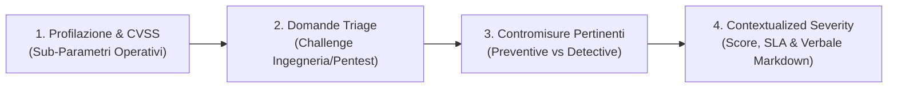

# What If — Vulnerability Triage & Contextualized Severity Copilot

> Un workbench interattivo di **Risk-Based Vulnerability Management (RBVM)** progettato per supportare gli analisti di sicurezza durante i tavoli di condivisione tecnica con Ingegneria del Software, DevOps e Pentester.

---

## 🎯 Visione & Filosofia

Nel Vulnerability Management tradizionale, la severità di un finding viene spesso affidata al solo punteggio **CVSS Base teorico**, portando a lunghi dibattiti sterili o a silenzi imbarazzanti durante le riunioni di triage:
- Da un lato, i report di penetration test tendono a sovrastimare l'impatto (es. *Critical RCE* o *Account Takeover* immediato).
- Dall'altro, gli sviluppatori faticano a comprendere il rischio reale nel loro specifico perimetro architetturale.

**What If** colma questo divario codificando oltre un decennio di esperienza sul campo in uno strumento guidato che consente all'analista (anche junior) di:
1. **Smontare la rigidità del CVSS** tramite sotto-label operative concrete (es. *Internet-facing* vs *Corporate VPN* vs *LAN interna* sotto la branca *Network*).
2. **Condurre la riunione con domande tecniche puntuali** ritagliate sulla famiglia di vulnerabilità (XSS, SQLi, SSRF, Auth, Cloud) per scoprire vincoli architetturali reali e sfidare i claim del pentester.
3. **Applicare contromisure tecniche pertinenti** differenziando nettamente tra controlli *Preventive* (che abbattono matematicamente il CVSS ambientale) e *Detective* (che azzerano il dwell time e riducono l'MTTD).
4. **Concordare una *Contextualized Severity* oggettiva** con relativa priorità di remediation (*P1* – *P4*) ed esportare con un click il verbale della condivisione pronto per Jira o Confluence.

---

## 🛠️ Architettura e Stack Tecnologico

- **Frontend**: [Vue.js 3](https://vuejs.org/) (Composition API, `<script setup>`), [PrimeVue](https://primevue.org/), [Tailwind CSS](https://tailwindcss.com/), [Vite](https://vitejs.dev/).
- **Backend**: [Python 3.11](https://www.python.org/), [Django 5](https://www.djangoproject.com/) & [Django REST Framework](https://www.django-rest-framework.org/), libreria standard `cvss` (First.org specification).
- **Infrastruttura**: Completamente containerizzata con Docker e Docker Compose, con supporto Hot-Module-Replacement (HMR) e live reloader.

---

## 🚀 Avvio Rapido (Docker Compose)

Il progetto è pre-configurato per essere avviato in un comando:

```bash
# Clona il repository
git clone https://github.com/<tuo-utente>/whatif.git
cd whatif

# Costruisci e avvia i container
docker compose up --build
```

Una volta avviato, i servizi saranno disponibili su:
- **Frontend Web UI**: [http://localhost:5173](http://localhost:5173)
- **Backend REST API**: [http://localhost:8000/api/data/](http://localhost:8000/api/data/)

---

## 🧭 Struttura del Flusso di Triage (4 Fasi)



### 1. Profilazione & Sotto-Parametri Operativi
Consente la ricerca istantanea nel catalogo vulnerabilità normalizzato. Per ogni metrica CVSS (AV, AC, PR, UI, S, C, I, A), l'analista seleziona la macro-branca (es. `Network`) e visualizza le sotto-opzioni concrete estratte dalla matrice di correlazione architetturale, con spiegazioni chiare e contestualizzate.

### 2. Domande di Triage & Pentest Challenge
In base alla tipologia di vulnerabilità selezionata (XSS, SQL Injection, SSRF, Autenticazione, Cloud Misconfiguration), l'analista ha a disposizione una guida tecnica specifica con:
- **Cosa chiedere in riunione**: la domanda esatta da porre al team.
- **Cosa ascoltare nella risposta**: suggerimenti tecnici per comprendere se la vulnerabilità è mitigata (es. cookie con flag `HttpOnly`, IMDSv2 forzato, least privilege DB).
- **Opzioni di riscontro**: per registrare la postura tecnica emersa dal tavolo.

### 3. Contromisure Tecniche Pertinenti
Presenta esclusivamente i controlli architetturali applicabili a quella specifica vulnerabilità (niente rumore o difese irrilevanti):
- **Preventive**: alterano i modificatori ambientali CVSS 3.1 (`MAC`, `MPR`, `MC`, `MI`, `MA`), garantendo matematicamente che il rischio ricalcolato non peggiori mai rispetto al valore base.
- **Detective**: controlli di telemetria e monitoraggio (es. SIEM, EDR) che attestano la riduzione del Mean Time To Detect (MTTD) senza falsare impropriamente l'exploitability intrinseca.

### 4. Contextualized Severity & Verbale di Condivisione
- **Score Dial & Delta**: visualizza l'abbattimento del rischio rispetto al Base score originario.
- **Action Priority concordata**: da *P1 - Critical Priority* a *P4 - Mitigated / Accepted Risk*, con indicazioni sui tempi e modalità di rilascio.
- **Tracciabilità dei Vettori**: confronto visivo tra vettore base e vettore ambientale generato.
- **Pulsante "Copia Verbale"**: copia negli appunti un riassunto formattato in Markdown pronto da incollare nel ticket Jira o nel verbale di riunione.

---

## 📂 Struttura della Repository

```text
whatif/
├── backend/
│   ├── api/
│   │   ├── engine.py              # Motore matematico di calcolo CVSS Environmental
│   │   ├── views.py               # Endpoint DRF (/api/data/, /api/calculate/)
│   │   └── urls.py
│   ├── config/                    # Configurazione Django
│   ├── cvss_submetrics.json       # Tassonomia sotto-parametri CVSS operativi
│   ├── technical_triage_questions.json # Domande tecniche specifiche per famiglia
│   ├── countermeasures.json       # Catalogo controlli tecnici e affinità CWE
│   ├── sn_vul_app_vul_entry_cleaned.json # Dataset vulnerabilità normalizzato
│   ├── Dockerfile
│   └── requirements.txt
├── frontend/
│   ├── src/
│   │   ├── App.vue                # Interfaccia interattiva a Tab per il Triage
│   │   ├── main.js                # Setup PrimeVue e Tailwind
│   │   └── style.css
│   ├── Dockerfile
│   ├── package.json
│   ├── tailwind.config.js
│   └── vite.config.js
├── docker-compose.yml             # Orchestrazione container
├── matricecorrelazione.md         # Matrice dottrinale sotto-label operativi / CVSS
├── .gitignore
└── README.md
```

---

## 📄 Licenza

Rilasciato sotto licenza MIT. Libero per utilizzi interni e adattamenti in team di Security & Vulnerability Management.
